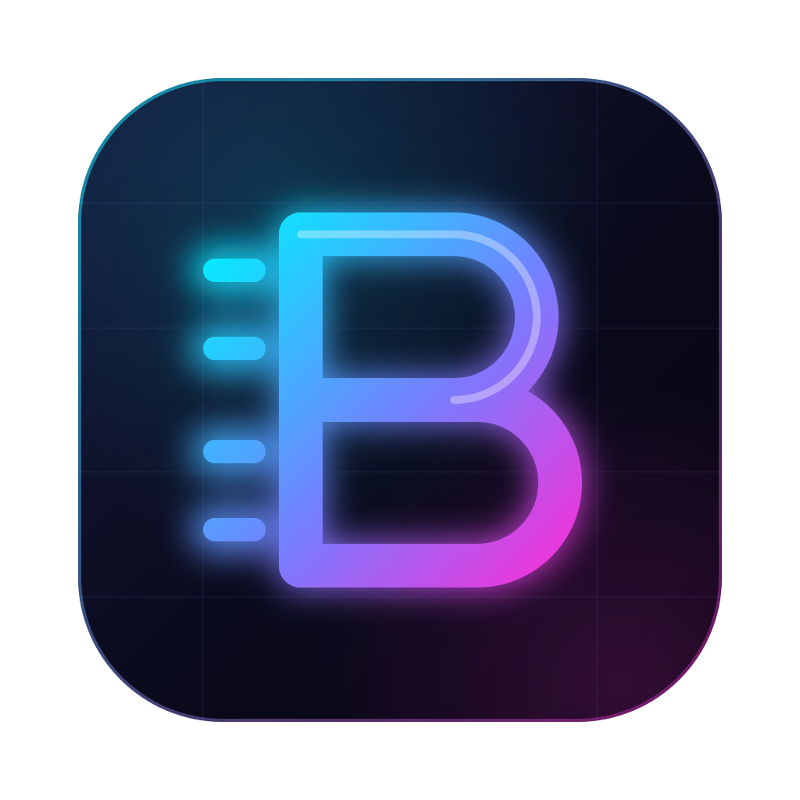

<p align="center">
  
</p>

<h1 align="center">BYTE</h1>
<p align="center"><b>A private AI assistant that runs on your own computer, your phone and your own cloud.</b><br/>
No account. No subscription. Your chats and files stay on your device.</p>

<p align="center">
  <a href="../../releases">Download</a> ·
  <a href="docs/mac-app.md">Mac</a> ·
  <a href="docs/WINDOWS-TESTING.md">Windows</a> ·
  <a href="docs/ANDROID.md">Android</a> ·
  <a href="docs/VERSIONS.md">Versions</a> ·
  <a href="CHANGELOG.md">Changelog</a>
</p>

---

## The apps

One app, built for each device. They look the same everywhere and follow each system's own habits for dialogs, notifications and install.

| | Status | Get it |
|---|---|---|
| **Mac** (Apple Silicon, macOS 13.3+) | Released, current version 0.12.6 | `.dmg` or Homebrew, see [the Mac guide](docs/mac-app.md) |
| **Windows** (10 and 11, x64 and ARM64) | Test builds, version 0.12.6-win.x | `…-setup.exe` on the [releases page](../../releases) |
| **Android** (phones up to 16 GB of RAM) | Test builds | `.apk` on the [releases page](../../releases), see [the Android notes](docs/ANDROID.md) |
| **Linux** | Planned | |
| **BYTE Cloud** (optional, invite only) | Running | Lets a device use bigger models, with the device itself as the fallback ([how it works](docs/CLOUD-MODE.md)) |

Test builds are for trying things out and reporting problems, not for daily use yet. They are not signed with a paid certificate, so the first launch asks you to confirm (Windows: **More info → Run anyway**; Mac: see the guide).

## What it does

- **Chat with a capable model on your own hardware**, even offline. Four modes: Fast, Auto, Deep and Extended.
- **Research with sources:** web search and reading with numbered citations, deep research, fact-checks, comparisons and YouTube summaries.
- **Your files:** PDFs, Office files, scans and photos; a searchable knowledge base of your folders; writes real PDF, PowerPoint and Word documents.
- **Writing and learning:** a writing studio, translation, flashcards, quizzes and a tutor.
- **Everyday helpers:** to-dos, reminders, timers, a daily briefing, page watchers and automations.
- **Notes, mind maps and a brainstorm board**, Quick Ask from anywhere, and a command palette.
- **Voice:** dictation, spoken answers in thousands of free natural voices, and **Hey BYTE**.
- **Private by design:** an offline switch, an app lock, a log of everything BYTE did, kids mode, encrypted backups, and erasing everything in one step.
- **Yours:** 20 themes or your own, personality and talk-style settings, and a help center with a step-by-step tutorial that works offline.

Every feature is a module you can turn off, and anything that listens, looks at your screen or controls your computer starts **off** and has its own switch.

### Hey BYTE (Windows, with Mac and Android following)

Say "Hey BYTE" and ask. It answers right away in a short, natural voice, can be interrupted by talking over it, and follows the person who said the wake phrase. It also handles timers, notes, "where did I leave off", translation, reading aloud and spoken download notices. Talk styles: Casual, Direct, Unhinged and Auto. It stays quiet during calls and games, and is never on in private chats or kids mode.

### Controlling the PC (Windows)

All of this is off until you switch it on in Settings, and you can do it by voice or by typing:

- **PC control:** open and use apps, change settings, find files and show them in File Explorer, with an approval step and run limits you choose.
- **Browser control:** research and fill in pages in a visible window or your own browser, with site rules you set.
- **Screen questions and a rolling replay:** ask about what is on screen or what just happened in a game. Nothing is sent without your say-so, and a badge shows when it is recording.
- **Guided help:** "Show me as I go" highlights where to click; "Do it for me" does it with your approval.
- **Chat apps, email and jobs:** connect your own Discord, Telegram or Slack bot or your mail (each off until you set it up), get drafted replies you approve, ask your computer from your phone, and save jobs that run on a schedule or when a download finishes, a file appears or a message arrives, including a spoken morning digest.
- **Routines, system status and backup:** voice routines you add or remove, "how's my PC", and saving and restoring your settings and chats.

## Install

- **Mac:** [the Mac guide](docs/mac-app.md) (Homebrew or `.dmg`).
- **Windows:** download `BYTE_…_x64-setup.exe` (or the `arm64` one) from [Releases](../../releases) and run it. BYTE then updates itself, after checking that each update was signed by BYTE's maker.
- **Android:** open the [releases page](../../releases) on the phone, tap the `.apk` and allow installing from the browser when Android asks.

The first launch walks you through picking a model that fits your device. Models download once and then work offline.

## Privacy

- The model runs on your device. Prompts, answers and files are processed locally.
- The internet is used for model downloads, web search and reading when you ask something that needs it, and BYTE Cloud if you connect it.
- The built-in engine listens only on `127.0.0.1` and needs a random key per launch, so other programs cannot use it.
- Chat history is stored in an encrypted database. API keys live in the system keychain, never in files.

## Build it yourself

```sh
npm install
scripts/build-llama-server.sh      # builds the engine for this machine (pinned in scripts/LLAMA_TAG)
npm run tauri dev                  # run the app
```

| Task | Command |
|---|---|
| Front end: type-check, tests, build | `npm run typecheck` · `npx vitest run` · `npm run build` |
| Rust tests | `cd src-tauri && cargo test` |
| All checks before a push | `scripts/check-all.sh` |
| Set the version everywhere | `node scripts/bump.mjs 0.12.7` |

**Stack:** Tauri 2 (Rust) · React 19 + TypeScript + Vite · llama.cpp · Qwen3 and other GGUF models.

```
src/                 React UI (components, state, themes)
src-tauri/src/       Rust core: engine, models, chat, tools, voice, wake word, PC control, screen, browser
  control/           PC control (Windows)
  screen/            screen questions and replay
  web_agent/         browser control
docs/                guides, release notes and design notes
scripts/             engine builds, model catalog, version bump
```

More: [project guide](docs/PROJECT_GUIDE.md) · [design and platforms](docs/DESIGN-AND-PLATFORMS.md) · [Windows packaging](docs/WINDOWS-PACKAGING.md) · [Hey BYTE](docs/HEY-BYTE-ASSISTANT.md).
